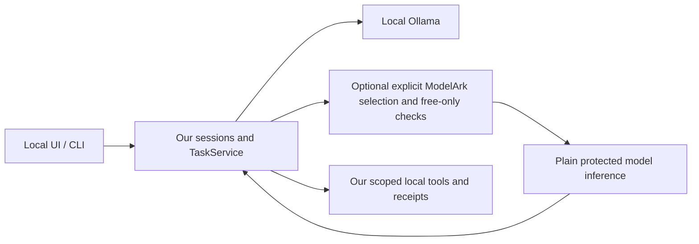

# ModelArk for this platform, with no paid usage

12 October 2026, Asia/Calcutta. Official documentation research and offline
compatibility preparation; no ModelArk inference, purchases, service activation,
resource creation, campaign enrollment or account changes were performed.

## Recommendation and current evidence

ModelArk is useful as an optional hosted model provider for AI full-stack work:
architecture, debugging, refactor proposals, code review and evaluation examples.
Our projects, conversations, permissions and local tools remain in our platform.
It does not replace the agent runtime or make its hosted agent services free.

The user's screenshots show GLM-5.2 `glm-5-2-260617`, approximately 496,697 of
500,000 free tokens remaining, and several other activated language models with
500,000-token balances. This is a screenshot observation, not a current API balance
query. The user subsequently explicitly reported **Free Tokens Only mode On**.
That report matters more than the balance display: according to the official
[Free Tokens Only documentation][free-only], this account-level mode consumes the
platform's free token quota and automatically suspends supported online inference
before additional token charges. Never disable it to continue after suspension.

This is a conditional basis for using supported plain model inference, not proof
that every resource in the account is nonbillable. Existing subscriptions, hosted
compute, storage, plugins or other clients may have independent charges. I have
not inspected the user's invoices, payment settings, card or private account.
The reported prior Seedance auto-debit does not identify whether money came from
the balance, a card, auto-recharge or another payment mechanism.

## What the credits and controls mean

| Item | Meaning | Decision for this project |
| --- | --- | --- |
| 500K free inference tokens | A consumption allowance for the applicable model, covering eligible online input/output/cache-hit tokens | Use only with free-only protection confirmed On |
| Cash, purchased Credits or a resource pack | Different billing-account assets with their own scope/validity | Do not treat these as an unlimited free service |
| Activated model | Service is enabled; remaining eligible free quota may be used first | Activation alone is not a charge prohibition |
| Model usage limit, RPM or TPM | Limits on usage or throughput | Not the same as Free Tokens Only mode |
| Free Tokens Only mode | Account-level suspension of supported token inference at its free limit | Keep On; do not bypass its suspension |
| Billing/usage graphs | Accounting information that may arrive after use | Monitoring, not an immediate spending barrier |

The [free-inference quota guide][free-quota] says quotas are per model and shared
under the primary account, including sub-accounts. A coworker's use of the same
model can reduce the allowance. These are tokens, not requests or currency;
conversation history, tool definitions, tool results and reasoning/output consume
tokens. A large advertised context window is not a sensible free-quota budget.

Free-only suspension can happen while another displayed resource-pack balance
remains. The documentation distinguishes the initial 500K allowance from the
account's total resource packages and warns of accounting delay. Treat the actual
quota-stop response as authoritative; do not retry with protection disabled.

The [billing-account guide][billing-account] separately describes **Automatic
billing** (charges can be collected from the bound payment method at an account
threshold or monthly settlement) and **Pay by credits** (consumption bills use
account assets). Switching from Automatic billing to Pay by credits without a
credit limit requires buying at least USD 5 of credits. Do not make that purchase
or treat an account-type switch as a no-cost workaround. We have not verified
which account type the user has. The protected token-inference path and the
financial account's collection mechanism are separate.

The documented stop is HTTP 429 / `SetLimitExceeded`. A production integration
should stop that cloud path or explicitly use a local model. It must not enable
paid inference, move to an unprotected key/account/model, or turn the mode off.
The current client reports generic HTTP errors; provider-specific quota handling
and billing verification are not implemented by the small URL fix below.

Eligibility is restricted. The official page says new accounts must enable the
mode before activating services without it; it cannot be re-enabled after being
disabled. Earlier uncertainty about eligibility was resolved by the user's
explicit current On report, not by an assumption from the screenshots.

## Services excluded from our use

The [quota guide][free-quota], [pricing][pricing] and
[knowledge-base billing][knowledge-pricing] distinguish these from eligible
online model tokens:

- Hosted Managed Agents: model tokens **plus runtime plus tool fees**. The current
  pricing page lists runtime at USD 0.08/hour and `web_search` at USD 0.006/request.
  `web_fetch` is described as free for a limited time; it does not make the entire
  agent free. We will not create or run hosted agents.
- Plugins, cloud MCP and third-party tools: may have independent provider fees.
  The screenshots' Search/Canvas chips do not prove they are covered by free tokens.
  Avoid them; our first use is plain chat with no provider tools.
- Hosted knowledge bases: compute/storage, parsing, embeddings, reranking and
  model use have separate billing. Standard knowledge-base compute is listed at
  USD 0.0416/hour. Keep files/history/retrieval under our own local implementation.
- Explicit context-cache storage: free token quota can offset eligible cache-hit
  inference, **not storage**. Implicit cache is different: its storage is documented
  as free. Do not enable explicit caching or purchase storage/model units.
- Batch, fine-tuning, model units, subscriptions and paid deployment services:
  do not assume online token credits cover them. Exclude them from this work.
- Seedance/Seedream and other media generation: outside the user's authorized
  language-model-only trial. No media request will be made.

The [model service billing guide][service-billing] documents near-real-time and
hourly settlement with delays. “I can see no bill yet” is not protection. Disabling
auto-recharge alone also does not prove an account cannot incur postpaid charges.

## Do not join the daily-token campaign

The screenshot advertises up to five million tokens daily through a Data
Collaboration Rewards Campaign. Its [official terms][rewards] explicitly instruct
participants to **disable Free Tokens Only mode**. That conflicts with this user's
no-charge requirement, and disabling the mode is documented as irreversible.

The campaign also exchanges authorized input/output use for resource packages.
The terms describe rights to use authorized data to maintain/develop/improve model
services and underlying technology, and retained rights after withdrawal for
already authorized data. Company code, client documents, personal records or
credentials must not be enrolled casually. The user being a company AI full-stack
developer is not evidence that the company authorized this data-sharing program.

Other material conditions: packages are scoped to applicable models/billing items,
have validity periods, and issuance/eligibility depend on provider rules. The page
announces that 18 models stopped receiving daily packages from 8 October 2026,
while API access continues. Existing packages can expire. It also retains a 2025
campaign-expiration clause alongside newer ongoing-benefit notices. Those mixed
dates do not establish present entitlement. None of this is our spending barrier.

## Coding Plan and Hermes are separate choices

ModelArk's Coding Plan is a **paid subscription**, distinct from the 500K free
inference allowance. The documentation has a Hermes integration guide, but that
guide is for Coding Plan. Its special endpoints are `/api/coding` or
`/api/coding/v3`; it warns that a subscriber using the normal `/api/v3` endpoint
incurs additional charges instead of consuming plan quota. Coding Plan also has
restrictions on permitted coding-tool usage. We will not buy or use it.

If we later adopt Hermes, it could still use a standard model-provider adapter
under the same free-only constraints. An open-source runtime is not a free
inference subscription. No Hermes integration or ModelArk live call was tested.

## Useful workflows for the user's role

| Workflow | ModelArk's potential contribution | What remains ours |
| --- | --- | --- |
| Architecture/design review | Compare API boundaries, database schemas and implementation approaches | Project files, decisions and review history |
| Full-stack debugging | Analyze a minimal sanitized reproduction and propose a patch | Actual tests, local execution and acceptance |
| Code review | Find edge cases, suggest refactors and explain tradeoffs | Repository scopes and source review |
| Agent evaluation | Generate synthetic routing/tool/JSON test cases and candidate answers | Evaluation corpus, deterministic tests and measurements |
| Difficult task planning | Produce a plan for a selected task | Permission checks, cancellation, tools and receipts |

This is a capability-based recommendation, not a measured claim that a hosted
model solves every task or always beats the current local models. GLM-5.2 is a
reasonable review candidate because the selected version's official model list
documents reasoning, text and tool use. Start with one short read-only question,
not autonomous loops or a full repository upload. Use public/synthetic or company-
approved sanitized input; hosted inference sends its submitted content off-device.

The known local coding failure makes a good future comparison case:
`unique_in_order([1, 2, 1, 3, 2])` must return `[1, 2, 3]`. Generate a candidate
answer, then run trusted tests locally. A generated answer is not itself validation.

## Technical integration: prepared, still disabled

The [regional guide][regions] and [Chat API guide][text-generation] specify:

```text
Base URL: https://ark.ap-southeast.bytepluses.com/api/v3
Chat path: /chat/completions
Model ID: glm-5-2-260617
Credential binding: ARK_API_KEY (backend environment only)
```

Our existing OpenAI-compatible branch previously appended `/v1/chat/completions`
to every base URL not ending in `/v1`. That produced the incorrect
`/api/v3/v1/chat/completions`. A minimal fix now preserves an explicit `/vN`
base-path suffix. Tests against a local HTTP fixture reproduced the wrong path
and passed after the fix. No BytePlus SDK or new dependency was installed.

The [disabled model example](../../../examples/modelark-glm-free-only.json) contains
only a key **name**, not a secret. To register the disabled record locally:

```powershell
.\.venv\Scripts\python.exe main.py models add examples/modelark-glm-free-only.json
.\.venv\Scripts\python.exe main.py models show modelark-glm-review
```

Adding/showing this record uses SQLite only. It does not call the provider,
download weights, enable a model in BytePlus or change an existing specialist.
It is preparation, not a completed live integration. The runtime additionally
requires `--allow-remote-models` and an enabled model before remote inference.
Neither was activated for this candidate during this task. Do not paste keys into
chat, put them in source/frontend code, or use an all-resource key when model-
scoped permissions are available. The [API-key guide][api-keys] supports model/
endpoint scopes and IP allowlists; control-plane IAM permissions are separate.

Limits still requiring work before autonomous use:

- Our remote adapter does not enforce `context_length` or translate the Ollama
  `thinking` flag into ModelArk-specific reasoning parameters.
- It currently logs completion tokens only, not a full input/output/reasoning
  usage ledger. A client ledger is useful, but does not replace server protection.
- Model-specific strict JSON-schema support must be checked. GLM-5.2's listed
  capabilities do not establish that it accepts our Manager/recruitment schema.
- [Agent invocation guidance][agent-invocation] says models including GLM-5.2 may
  need `reasoning_content` passed back in multi-turn tool use; newer Seed models
  can require encrypted reasoning blocks. Our normalized messages currently drop
  those fields. Do not claim autonomous tool-loop compatibility from the URL fix.
- Request budgets must cover history, schemas and repeated calls. ModelArk's
  `max_completion_tokens` can include reasoning and cannot be combined with
  `max_tokens`; use the selected model's documented parameter support.
- Stop on free-quota suspension; do not configure an unprotected cloud fallback.

Proposed connection after those checks:



The optional checks/usage ledger in the diagram are proposed work, not an
implemented billing-policy subsystem. Keep the local default and private state.

## Missing disk and continuing work

The last successful Windows installation was `D:\Projects\Local-AI-Agent`.
The user now lacks the previously inserted disk and is not sure whether that
folder is still accessible. Neither the former D: free space nor the former C:
free space is a current measurement.

Read-only PowerShell checks:

```powershell
Get-PSDrive -PSProvider FileSystem | Select-Object Name, Root, Used, Free
Test-Path 'D:\Projects\Local-AI-Agent\main.py'
Test-Path 'D:\Projects\Local-AI-Agent\data\platform.sqlite'
Get-Command python, git, ollama -ErrorAction SilentlyContinue
Test-Path "$env:USERPROFILE\.ollama\models"
```

Source is retained in GitHub and the cloud checkout. If the D: source is absent,
clone into a **new unused internal-drive folder** after checking current free
space, then recreate `.venv`; do not overwrite another checkout/database. This
restores source, not previous conversations or project files. Those require the
old `data/platform.sqlite`, selected `workspace/` files or a private backup.
Ollama weights normally live separately in the user profile unless its model
directory was overridden. Check existing installation/model files before pulling
anything. Do not download all models again automatically.

Protected hosted inference could eventually avoid loading that model's weights
on the laptop, but it requires network access and safe setup. It does not recover
the missing disk's private data, and free allowance is finite. Cloud development
can continue without the office laptop or external disk.

## Research coverage and verification

The [source catalog](2026-10-12-sources.json) records public HTTPS retrievals and
content digests. The documentation navigation inventory contained 529 entries,
including API references, older entries and paid-plan material. We retrieved
155 ModelArk URL variants and extracted 134 document bodies, plus two financial
documents; surveyed topic outlines and closely read the relevant billing, quota,
campaign, API, capabilities and integration material. This is not a claim that
every one of 529 entries was read fully. Some paths returned a JavaScript shell
or had no published body; canonical official lowercase-library aliases recovered
the campaign, Coding Plan and InfoQuest documents. No login was used.

The full Linux suite passed **79 tests** after the URL regression. The disabled
config was validated locally. Live ModelArk inference, account billing behavior,
model quality and Windows execution of this change are untested. No API key was
requested or used. User confirmation of free-only On is recorded as user evidence.

[free-only]: https://docs.byteplus.com/en/docs/ModelArk/free-tokens-only-mode
[free-quota]: https://docs.byteplus.com/en/docs/ModelArk/free-inference-quota
[pricing]: https://docs.byteplus.com/en/docs/ModelArk/model-pricing
[knowledge-pricing]: https://docs.byteplus.com/en/docs/ModelArk/knowledge-base-pricing
[service-billing]: https://docs.byteplus.com/en/docs/ModelArk/model-service-pricing
[rewards]: https://docs.byteplus.com/en/docs/modelark/collaboration-reward-program
[regions]: https://docs.byteplus.com/en/docs/ModelArk/region-availability
[text-generation]: https://docs.byteplus.com/en/docs/ModelArk/text-generation
[api-keys]: https://docs.byteplus.com/en/docs/ModelArk/manage-api-keys
[agent-invocation]: https://docs.byteplus.com/en/docs/ModelArk/agent-model-invocation-practice
[billing-account]: https://docs.byteplus.com/en/docs/byteplus-platform/billing_account
