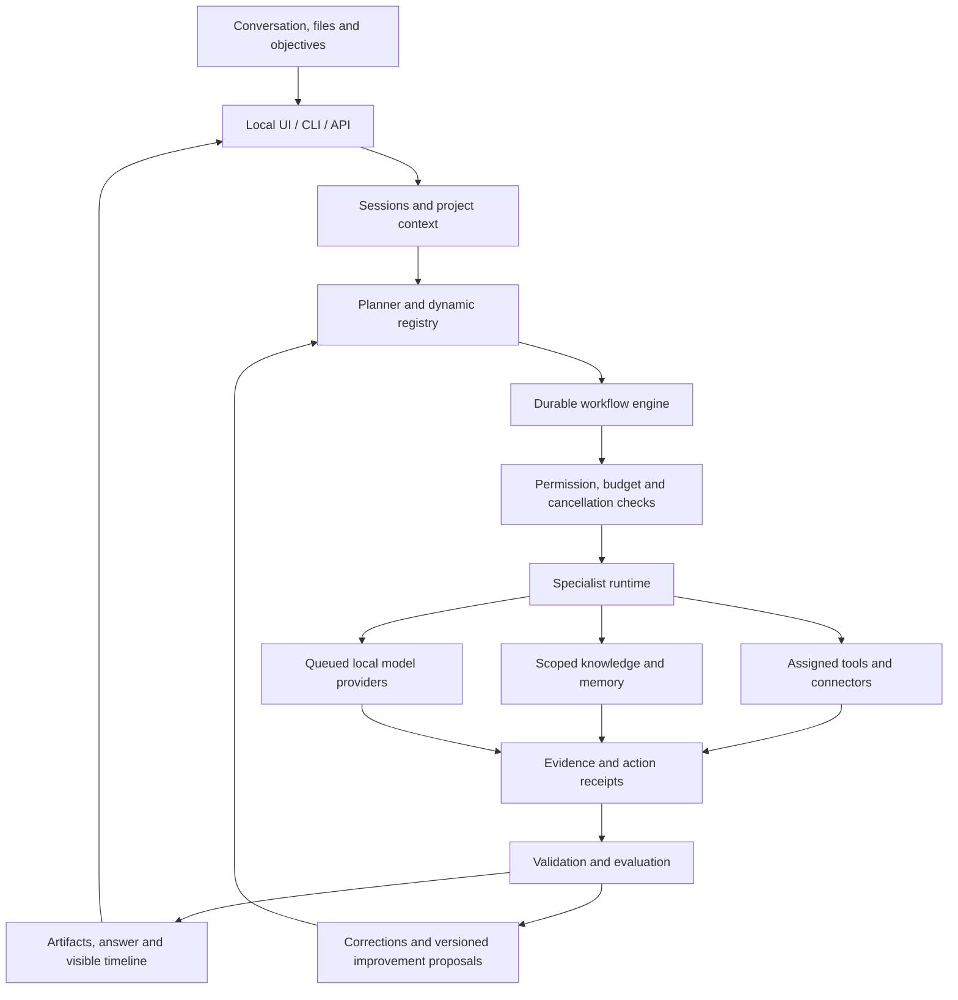

# Evolving local agent platform roadmap

10 October 2026. Research-informed proposal, not a frozen feature list or an
implementation claim. Revise priorities as the user's vision becomes clearer and
as actual workflows reveal what matters.

## Product direction

Create a local assistant that understands an ongoing conversation, researches with
evidence, coordinates configurable specialists, performs permitted work, and shows
what happened. The user confirmed that both Grok's conversational/research behavior
and autonomous tool execution inspired this direction.

The original recruitment, marketing, developer and SEO examples are starter uses.
The platform should also support specialists and workflows not yet imagined,
through configuration and stable capability interfaces.

Success means a useful result with supporting evidence, not merely a completed
model request. A first-class experience includes conversation continuity, editable
artifacts, visible progress, recoverable work and a clear distinction between a
prepared action and a confirmed external result.

## Three approaches considered

| Approach | Benefit | Tradeoff |
| --- | --- | --- |
| **Extend our core with shared service interfaces — recommended** | Preserves the working registry, scopes, audit data and local providers; new interfaces reuse the same engine | We own session, workflow and evaluation engineering |
| Wrap a larger open-source runtime | Could accelerate some tools, skills and UI features | Must reconcile its credentials, permissions, storage, resource use and sandbox assumptions with ours |
| Integrate hosted platform services | Useful for a specialized capability or a fast prototype | Introduces network dependencies, credentials, possible costs and data transfers |

Use external components behind replaceable adapters where they provide a measured
benefit. A wholesale runtime replacement is not required by this research. No paid
Lyzr service or new model download is part of this proposal.

## Proposed component boundaries

The diagram shows the proposed architecture. Only registry, specialist execution,
local providers, scoped local tools and task-event persistence exist today.

Suggested interfaces are conceptual boundaries, not final module signatures:

- `SessionService`: own conversations, project links and bounded context assembly.
- `TaskService`: submit tasks and expose status/events through both API and CLI.
- `WorkflowService`: validate plans, journal steps, recover jobs and manage waits.
- `KnowledgeProvider`: return evidence fragments with source and permission metadata.
- `MemoryProvider`: retrieve/correct scoped lasting context independently of logs.
- `ToolAdapter`: validate and execute a specific action with a result receipt.
- `PolicyService`: check current authorization, scope, budgets and cancellation.
- `EvaluationService`: run versioned cases and compare candidate configurations.

Keep existing implementations until a milestone needs a boundary extracted.
Avoid creating empty packages merely to match the diagram.

## Milestone 0 — preserve and measure the working baseline

**Now verified:** published snapshot restored, both models available, 58 tests pass,
local Marketing inference returns READY, and restored 4B routing selects Recruitment
for candidate evaluation. Details are in the
[published environment review](../validation/2026-10-10-published-environment-review.md).

Remaining baseline work during the next coding milestone:

- Preserve reviewed source through Git commits; distinguish that from the working
  cloud snapshot. Remote publication is a separate action.
- Audit and benchmark the actual Dell before choosing its execution model profile.
- Turn the existing routing, coding and tool-timeout failures into fixed evaluation
  examples. Keep their expected behavior visible when changing models or prompts.

Exit evidence: reproducible reviewed source, actual host measurements, and a small
evaluation corpus with known failures. Cloud CPU results cannot substitute for Dell
GPU measurements.

## Milestone 1 — persistent assistant workspace

**User experience:** open a local application, continue a conversation, attach files,
see a task's status and output, and return to the same project later.

Introduce persistent sessions and projects, a local service API, event delivery,
and a simple chat/task interface. Keep CLI commands as a supported client of the
same services. Distinguish progress events from token streaming; both are useful,
but neither is implemented by a spinner alone.

Introduce the minimal persistent job state needed to reconnect to a running task.
A page refresh must reconnect to the existing job rather than submit it again.
Support cancellation with documented boundaries; completed actions cannot be
undone merely because a later cancellation was requested.

A task display should show the selected agent/model, current operation, completed
tool receipts, source references, saved artifacts and validation outcomes. It
should remain usable when an inference request is slow on the Dell.

Exit evidence:

- Conversation context survives service restart within its scope.
- Two projects do not retrieve each other's context.
- Duplicate client submission returns the same task when using the same request key.
- A refreshed browser sees the current job and its existing event history.
- Cancellation prevents subsequent steps and records any already-completed work.
- Existing CLI behavior and permission enforcement remain tested.

## Milestone 2 — cited knowledge, public research and editable memory

**User experience:** ask a document or research question, see sources, correct a
lasting preference, and inspect what the assistant remembers about a project.

Create a small local knowledge index using existing extraction and SQLite full-text
search first. Preserve page/section provenance and source hashes. Add an embedding
adapter only when real evaluation shows where keyword retrieval is insufficient.

Add a bounded public-web research tool and a pluggable search provider. Fetching
known URLs and searching the web are separate capabilities; a URL reader alone
must not be presented as a complete search engine. Network-dependent research is
distinct from local inference and private-document processing.

Implement session context separately from lasting memory. Lasting entries carry
scope, source, timestamps and corrections. Start with explicit remembered facts
and user corrections; evaluate automatic extraction before enabling it broadly.

Exit evidence:

- Citations resolve to actual retrieved passages or web-source receipts.
- Unsupported questions produce an honest insufficient-evidence result.
- Document updates remove or supersede stale indexed fragments.
- A corrected memory supersedes the old value; forgetting affects retrieval.
- Scope checks run before retrieval and fetched text cannot grant new permissions.
- The default private-data path uses local storage and local model/embedding calls.

## Milestone 3 — coordinated and resumable work

**User experience:** state a larger objective and watch specialists collaborate on
a plan, producing an integrated result that can resume after interruption.

Extend the Manager from single routing into typed plan generation. Plans identify
dependencies, artifact inputs, workers, success criteria and permitted actions.
Use deterministic templates for repeatable workflows and dynamic planning when the
steps genuinely depend on the request. A workflow may include ordinary functions,
retrieval and validators; every node need not be another LLM call.

Add durable step records and worker leases. Steps should distinguish pending,
running, completed, failed, waiting, cancelled and uncertain external outcomes.
Reuse completed outputs during recovery. Bound step count, delegation depth,
retry count, total runtime and inference/resource consumption.

Initially keep model inference sequential. The graph can express parallel work
without forcing several models into limited VRAM at once.

Exit evidence:

- A newly registered specialist can appear in a valid plan without core changes.
- Invalid references, cycles and unauthorized tools fail before execution.
- A process restart resumes from stored steps rather than repeating all work.
- A transient read failure retries within its budget; a permanent failure is shown.
- The final result references its intermediate artifacts and check outcomes.
- Unknown external outcomes do not automatically trigger another write.

## Milestone 4 — agent studio, skills and reproducible blueprints

**User experience:** describe a specialist or workflow, inspect its generated
configuration, test it, and activate an identifiable version.

Add a conversational configuration builder and an editable form. Both use the
existing schema/registry. Extend schemas through migrations for explicit role,
goal, output contracts, memory/knowledge bindings and revision identity as needed.

Create export/import bundles for agents, skills, example inputs and evaluation
cases. Existing JSON remains supported; an OpenGAP compatibility adapter is an
optional later format, not a prerequisite for portability.

Skills declare procedures and required tools. Pin their versions and trust levels.
Imported scripts receive no automatic execution rights. Running code requires a
real local sandbox and relevant host testing.

Start with three complete blueprints: evidence-oriented recruitment preparation,
restaurant marketing preparation, and developer inspection/change verification.
They exercise generic interfaces and remain editable for other domains.

Exit evidence:

- Generated configuration rejects unknown tools/models and invalid relationships.
- An in-flight task stays pinned to the version it started with.
- Export/import retains behavior and capability assignments without secrets.
- A blueprint includes expected inputs, artifacts, failure handling and tests.
- Restoring an old version records a new activation without destroying history.

## Milestone 5 — connected actions and proactive routines

**User experience:** connect selected applications, prepare or carry out permitted
actions, and run recurring objectives without manually starting each one.

Add connectors in the order actual workflows need them. Start with reads and drafts
before externally visible writes. Credentials stay outside agent configuration;
actions carry explicit account, destination and scope. Where multiple users share
the application, their resource scopes and connector identities must remain separate.

Implement durable schedules and authenticated event triggers. Use Asia/Calcutta
for the user's schedules by default, with the selected timezone recorded. Define
overlap, catch-up, retry and deduplication behavior instead of relying on a process
being alive at the scheduled second.

Consequential actions require an exact prepared payload and the authorization
appropriate to that action. Routine reversible local work should progress under
the user's granted scope without repeated confirmation.

Exit evidence:

- A disabled tool cannot execute even if a plan was prepared earlier.
- Approval applies to a specific unchanged action, not an open-ended future request.
- Duplicate trigger deliveries produce one intended job.
- Connector idempotency or reconciliation handles crash-after-acceptance cases.
- A scheduled job behaves predictably when the machine was asleep/offline.
- Budgets and cancellation operate across all steps, including evaluation calls.

## Milestone 6 — measured improvement and optional new modalities

**User experience:** corrections improve later work, useful recurring insights
appear, and voice or image input can use the same underlying assistant.

Add failure clustering and configuration-improvement proposals tied to trace
evidence. Compare candidate versions against held-out cases and show the diff,
quality impact and latency/resource tradeoff. Activate and roll back according to
the configured policy. Prompt/skill improvements are not presented as model training.

Optional expansions include local speech recognition/synthesis, push-to-talk,
OCR, vision, richer artifact editors and additional trusted worker machines.
Add them as adapters so text use remains lightweight.

Exit evidence: a measured improvement survives held-out regression checks; a rollback
restores the prior configuration; each optional modality has real host latency,
accuracy and resource measurements.

## Future vision backlog

These are possibilities to preserve, not promised shipped features. Each entry
should acquire a concrete use case and evidence before implementation expands.

| Idea | Why it could matter | What would justify promoting it |
| --- | --- | --- |
| Company/project intelligence workspace | Shared context across marketing, development and operations | Repeated cross-domain tasks with the same project evidence |
| Event-driven assistant | React to changed files, new documents or selected application events | A specific recurring event and permitted action policy |
| Skill/template ecosystem | Add new specialists without core rewrites | Several successful reusable blueprints and trustworthy package handling |
| Personal conversational style | Make the assistant comfortable and consistent to use | User examples and feedback about tone and interaction |
| Local voice companion | Hands-free use and spoken progress | Acceptable STT/LLM/TTS latency on the actual host |
| Structured business intelligence | Query spreadsheet/database facts accurately | A real dataset, glossary and known correct query results |
| Knowledge graph | Reason over project/entity relationships | Questions that ordinary retrieval repeatedly fails |
| Sandboxed development agent | Produce and test changes with fewer manual steps | A working local isolation boundary and meaningful regression tests |
| Multi-machine workers | Use available hardware without changing agent definitions | Measured workload/resource pressure and authenticated worker channels |
| Offline install bundle | Operate private workflows without a live network | A tested artifact/update process and wholly local provider profile |
| Model fine-tuning | Improve a narrow capability from high-quality corrections | Enough suitable data, compute, evaluation and a demonstrated advantage |

## How this roadmap evolves

Keep a short vision and decisions log. New ideas can add goals, replace assumptions
or reprioritize milestones. Record why an idea matters, its proposed capability,
the next experiment or acceptance evidence, and whether it is proposed, building,
verified or parked. Parked means deferred, not rejected.

Select one coherent milestone for implementation at a time. Before coding it,
write the concrete interfaces, data migration, user flows and failure tests using
the current repository as evidence. Keep all broader ideas visible while avoiding
an unfinished implementation of every subsystem at once.

Research basis: [Lyzr analysis](../research/lyzr/2026-10-10-analysis.md) and
[source catalog](../research/lyzr/2026-10-10-sources.json). No milestone after the
baseline is claimed to be implemented by this research task.
